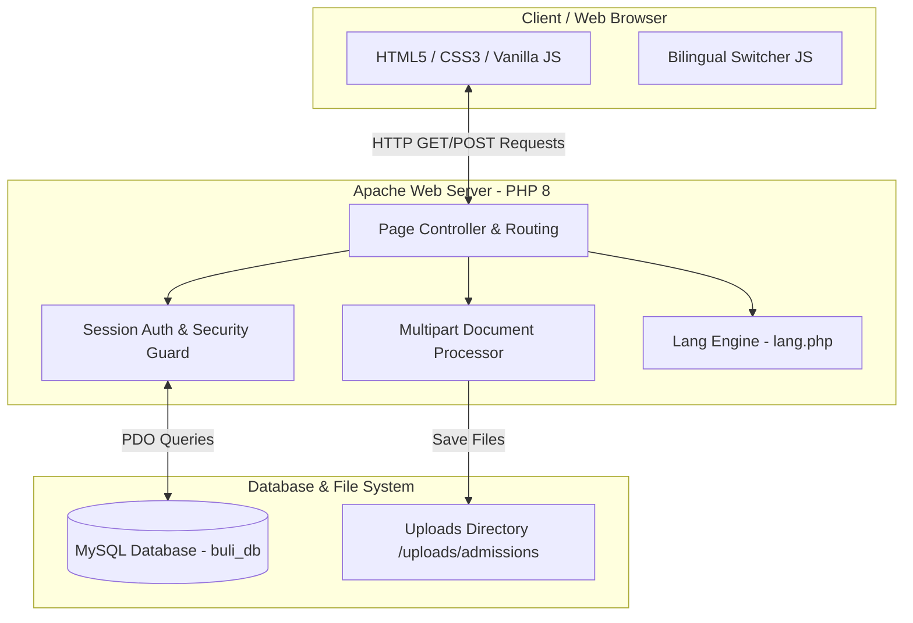
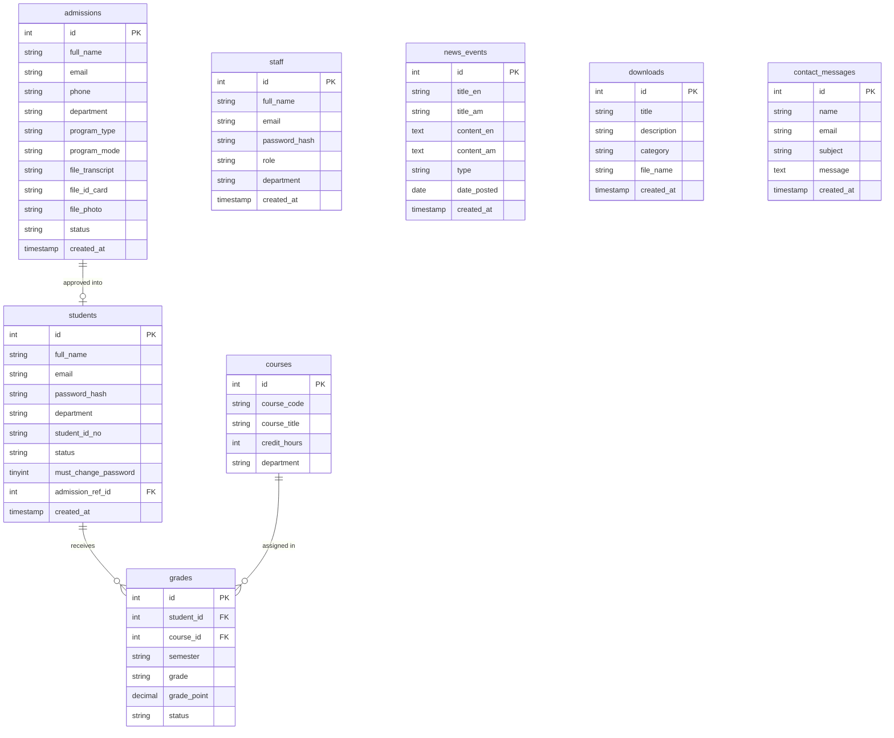
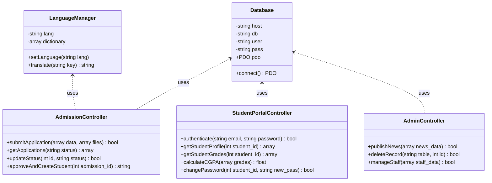
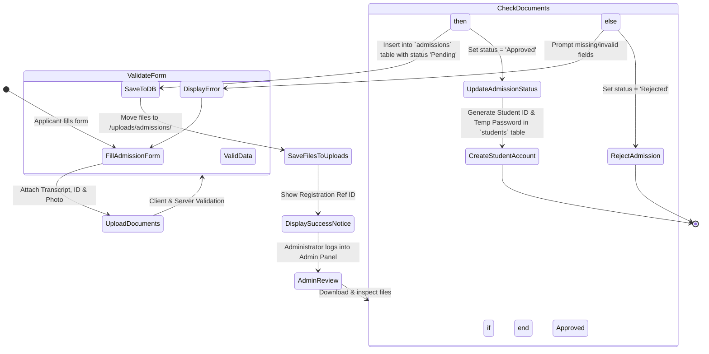
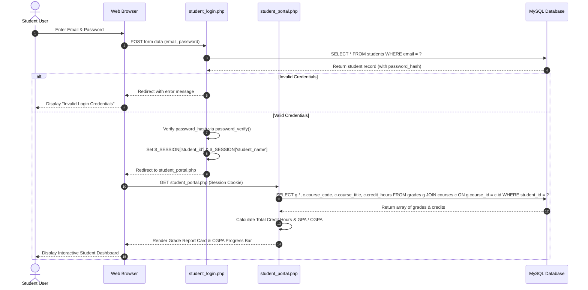
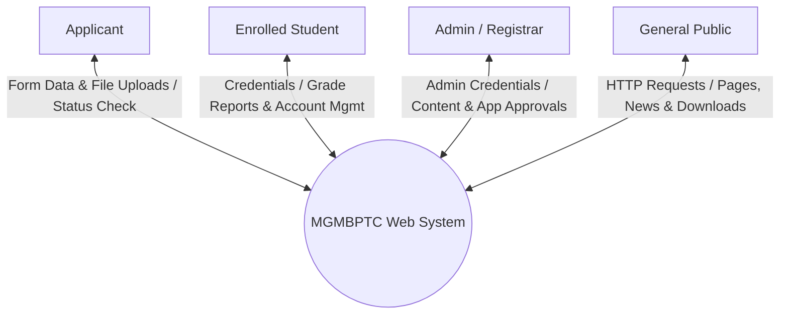

# Comprehensive Project Report: Major General Mulugeta Buli Polytechnic College (MGMBPTC) Institutional Web System

---

## 1. Executive Summary & Overview

### 1.1 Project Title & Abstract
* **Project Title:** Major General Mulugeta Buli Polytechnic College (MGMBPTC) Institutional Portal & Academic Management System
* **Abstract:** 
  The MGMBPTC Web System is an institutional web platform developed for Major General Mulugeta Buli Polytechnic College, located in Holeta, Oromia Region, Ethiopia. The project bridges the digital divide for technical and vocational education (TVET) by delivering a bilingual (English & Amharic), mobile-responsive online portal. It unifies public institutional marketing, dynamic news and announcements, dynamic online student admissions with document upload capabilities, a dedicated student portal for grade checking and course tracking, a staff portal for faculty updates, and an administrative management dashboard for content and applicant lifecycle management.

### 1.2 Problem Statement
Prior to this implementation, Major General Mulugeta Buli Polytechnic College relied heavily on physical noticeboards, paper-based application submissions, and manually dispatched academic grade cards. This traditional approach presented several institutional bottlenecks:
1. **Limited Geographic & Public Reach:** Prospective students outside Holeta had difficulty accessing program curricula, admission criteria, and academic requirements.
2. **Inefficient Admission Processing:** Physical handling of transcripts and identification cards caused administrative delays, lost documents, and high processing times.
3. **Communication Delays:** Emergency announcements, exam schedules, and registration deadlines failed to reach off-campus or evening-course trainees efficiently.
4. **Lack of Centralized Academic Portal:** Students lacked real-time, remote access to their semester GPA/CGPA, academic status, and official college publications.

### 1.3 Project Objectives
* **Digitize Admissions:** Provide an online application system allowing prospective students to upload transcripts, national IDs, and passport photos, reducing application processing time by 70%.
* **Provide Dual-Language Accessibility:** Deliver seamless bilingual support (English & Amharic) across all public pages.
* **Establish Student & Staff Self-Service Portals:** Enable secure login for students to review course grades, GPA/CGPA, and password management, while allowing staff access to institutional management toolsets.
* **Centralize Content Management:** Build a secure Admin Control Panel enabling administrative staff to manage news, announcements, photo/video galleries, downloadable resources, and applicant statuses without writing code.
* **Modernize Brand Aesthetics:** Implement a web visual design adhering to the college's official palette (Forest Green `#1e3f20` and Military Gold `#d4af37`), symbolizing excellence in technical and vocational training.

### 1.4 Target Audience & Stakeholders
* **Prospective Students & Applicants:** Explore TVET Level I–V programs, short-term evening courses, and submit digital admission forms.
* **Enrolled Students:** View semester grade reports, academic status, announcements, downloadable schedules, and update credentials.
* **College Faculty & Staff:** Access institutional resources, departmental communications, and administrative utilities.
* **College Administrators & Registrar Staff:** Review and approve/reject online applications, generate student IDs, update database records, publish news/events, and maintain college assets.
* **General Public, Partners & Government Stakeholders (e.g., MInT):** Review research publications, institutional achievements, and contact information.

### 1.5 Project Scope

```
+-----------------------------------------------------------------------------------+
|                                 IN-SCOPE FEATURES                                 |
+-----------------------------------------------------------------------------------+
| - Public Marketing Pages (Home, About, History, Mission, Academics, Contact)      |
| - Dynamic Admissions Portal (Form + Document Uploads for Transcript, ID, Photo)    |
| - Student Portal (Grade Card View, GPA/CGPA Calculator, Password Change)          |
| - Staff & Admin Portals (Applicant Processing, News & Notice Publishing)          |
| - Multilingual Engine (English <-> Amharic Dynamic Switching via Session/Cookie)  |
| - Resource Download Center & Media Gallery                                        |
+-----------------------------------------------------------------------------------+

+-----------------------------------------------------------------------------------+
|                             OUT-OF-SCOPE (FUTURE ITERATIONS)                       |
+-----------------------------------------------------------------------------------+
| - Online Fee Payment Gateway Integration (Telebirr / CBE Birr)                    |
| - Native Mobile Application (iOS / Android)                                       |
| - Live Interactive Video LMS (Full LMS handled via external Chamilo/Moodle link)   |
| - Automated SMS Notification Gateway for Application Updates                      |
+-----------------------------------------------------------------------------------+
```

---

## 2. System Architecture & Tech Stack

### 2.1 Tech Stack Overview
* **Frontend:**
  * **HTML5 & CSS3:** Semantic structure with custom CSS3 design system variables (`--primary-color: #1e3f20`, `--accent-color: #d4af37`, `--bg-light: #f4f6f4`).
  * **Vanilla JavaScript (ES6+):** Client-side form validation, dynamic DOM manipulation, real-time directory filtering, and interactive UI component state management.
* **Backend:**
  * **PHP (v8.0+):** Procedural & Object-Oriented script execution, session handling (`$_SESSION`), file upload processing, parameter sanitization, and password hashing (`password_hash` with BCRYPT).
* **Database:**
  * **MySQL / MariaDB (v10.4+):** Relational Database Management System utilizing InnoDB storage engine with UTF-8 (`utf8mb4_general_ci`) multi-byte encoding for Amharic script compatibility.
* **Server Environment:**
  * **XAMPP / Apache Web Server (v2.4+):** Module rewriting, local DNS resolution, virtual hosting, and HTTP request handling.

### 2.2 System Architecture Diagram
The application follows a classic 3-Tier Layered Architecture (Presentation Layer, Business Logic Layer, and Data Access Layer).



---

## 3. System Modeling & UML Diagrams

### 3.1 Use Case Diagram
Defines the main actors (Guest/Applicant, Student, Staff, Admin) and their interactions with system use cases.

```mermaid
usecaseDiagram
actor "Guest / Applicant" as Guest
actor "Enrolled Student" as Student
actor "College Staff" as Staff
actor "System Admin" as Admin

package "MGMBPTC Web System" {
    usecase "UC1: View Programs & News" as UC1
    usecase "UC2: Submit Online Admission" as UC2
    usecase "UC3: Upload Application Documents" as UC3
    usecase "UC4: Switch Language (EN/AM)" as UC4
    usecase "UC5: Student Login" as UC5
    usecase "UC6: View Grades & CGPA" as UC6
    usecase "UC7: Change Account Password" as UC7
    usecase "UC8: Staff/Admin Login" as UC8
    usecase "UC9: Manage Admission Applications" as UC9
    usecase "UC10: Manage News & Notices" as UC10
    usecase "UC11: Generate Student Accounts" as UC11
}

Guest --> UC1
Guest --> UC2
UC2 ..> UC3 : <<include>>
Guest --> UC4

Student --> UC5
Student --> UC6
Student --> UC7
Student --> UC4

Staff --> UC8
Staff --> UC10

Admin --> UC8
Admin --> UC9
Admin --> UC10
Admin --> UC11
```

---

### 3.2 Entity-Relationship Diagram (ERD)
Illustrates the database structure, table primary keys (`PK`), foreign keys (`FK`), attributes, and cardinalities.



---

### 3.3 Class / Component Diagram
Displays the core PHP backend modules, data structures, and operational helper dependencies.



---

### 3.4 Activity Diagram: Online Student Admission & Approval Workflow
Shows the step-by-step logic execution for student application and administrator review.



---

### 3.5 Sequence Diagram: Student Authentication & Grade Card Retrieval
Displays chronological message exchange during student login and grade report generation.



---

### 3.6 Data Flow Diagram (DFD Level 0 & Level 1)

#### Level 0 Context Diagram


#### Level 1 Data Flow Diagram
```mermaid
graph TD
    Applicant[Applicant] -->|1. Submit Application| P1[Process 1: Admission Processing]
    P1 -->|Store Record & Files| D1[(admissions Table & /uploads)]
    
    Admin[Admin] -->|2. Review Application| P2[Process 2: Application Approval & Registration]
    D1 -->|Fetch Pending Apps| P2
    P2 -->|Update Status & Create Credentials| D2[(students Table)]

    Student[Student] -->|3. Login Request| P3[Process 3: Student Auth & Portal Engine]
    D2 -->|Verify User| P3
    D3[(grades & courses Tables)] -->|Fetch Academic Records| P3
    P3 -->|Render Grade Card| Student

    Admin -->|4. Manage News & Events| P4[Process 4: CMS Engine]
    P4 -->|Insert/Update Content| D4[(news_events Table)]
    Public[Public User] <--|View News & Notices| P4
```

---

## 4. System Requirements

### 4.1 Functional Requirements

| Requirement ID | Module / Area | Description | Priority |
|---|---|---|---|
| **FR-01** | Multilingual Engine | The system must allow users to toggle between English and Amharic languages on any public page seamlessly. | High |
| **FR-02** | Online Admission | Prospective students must be able to complete an online application form selecting department, program type, and program mode. | High |
| **FR-03** | File Uploads | Applicants must be able to upload PDF/JPG images for Grade 10/12 Transcripts, National ID, and Passport Photos. | High |
| **FR-04** | Admission Processing | Admins must be able to view, filter, approve, or reject applicant submissions and view/download attached files. | High |
| **FR-05** | Student Account Creation | Upon approving an application, the system must automatically create a record in the `students` table with a generated Student ID. | High |
| **FR-06** | Student Portal Login | Students must be able to log into their private dashboard using their registered email and secure password. | High |
| **FR-07** | Grade Report & CGPA | Enrolled students must be able to view a breakdown of their courses, credit hours, semester grades, and calculated CGPA. | High |
| **FR-08** | Password Management | Students and staff must be prompted/allowed to change default or existing passwords securely (`password_hash`). | Medium |
| **FR-09** | News & Announcements | Admins must be able to publish bilingual news, events, and urgent announcements displayed on the homepage and news feed. | High |
| **FR-10** | Staff Directory Filter | Visitors must be able to search staff members by name or filter by department dynamically in real-time. | Medium |
| **FR-11** | Downloads Center | Visitors must be able to view and download official forms, academic calendars, and student manuals. | Medium |

### 4.2 Non-Functional Requirements

* **Performance & Speed:** 
  Page response time must be under 1.5 seconds on standard broadband local hosting. Database queries must utilize index optimizations on primary and unique keys (`email`, `course_code`).
* **Security & Data Integrity:**
  * All passwords must be stored using BCRYPT hashing (`password_hash()`).
  * SQL injection protection via PDO Prepared Statements with parameterized queries across all forms.
  * XSS (Cross-Site Scripting) prevention via `htmlspecialchars()` sanitization on user inputs.
  * Secure file upload handling with extension validation and file renaming to prevent remote code execution.
* **Usability & Design Aesthetics:**
  * Clean institutional design matching official colors (Forest Green `#1e3f20` and Gold `#d4af37`).
  * High readability with clean typography, contrast standards, and responsive cards/tables.
* **Compatibility & Responsiveness:**
  * Fully responsive execution across desktops (1920x1080), tablets (768px width), and mobile phones (375px+ width).
  * Cross-browser support for Google Chrome, Mozilla Firefox, Microsoft Edge, and Apple Safari.

---

## 5. Database Schema & Data Dictionary

### 5.1 SQL Database Schema Overview
Database Name: `buli_db` | Character Set: `utf8mb4` | Collation: `utf8mb4_general_ci`

```
  +-------------------+        +-------------------+
  |    admissions     |        |     students      |
  +-------------------+        +-------------------+
  | id (PK)           |        | id (PK)           |
  | full_name         |        | full_name         |
  | email             |        | email (UNIQUE)    |
  | phone             |        | password_hash     |
  | department        |        | department        |
  | status            |        | student_id_no     |
  | program_type      |        | status            |
  | program_mode      |        | must_change_pass  |
  | file_transcript   |        | admission_ref_id  |
  | file_id_card      |        +-------------------+
  | file_photo        |                  |
  | created_at        |                  |
  +-------------------+                  |
                                         | 1:N
                                         v
  +-------------------+        +-------------------+
  |      courses      |        |      grades       |
  +-------------------+        +-------------------+
  | id (PK)           |        | id (PK)           |
  | course_code (UQ)  |------->| student_id (FK)   |
  | course_title      | 1:N    | course_id (FK)    |
  | credit_hours      |        | semester          |
  | department        |        | grade             |
  +-------------------+        | grade_point       |
                               | status            |
                               +-------------------+
```

---

### 5.2 Detailed Data Dictionary

#### 1. Table: `admissions`
Stores prospective student application submissions and document attachment paths.

| Column Name | Data Type | Nullable | Key | Default Value | Description |
|---|---|---|---|---|---|
| `id` | INT(11) | NO | PK | AUTO_INCREMENT | Unique admission record identifier |
| `full_name` | VARCHAR(100) | NO | - | None | Applicant's full name |
| `email` | VARCHAR(100) | NO | - | None | Applicant's contact email address |
| `phone` | VARCHAR(30) | NO | - | None | Contact telephone number |
| `department` | VARCHAR(100) | NO | - | None | Applied TVET department name |
| `status` | VARCHAR(20) | YES | - | 'Pending' | Application state: `Pending`, `Approved`, `Rejected` |
| `program_type` | VARCHAR(100) | YES | - | NULL | Level of study (e.g., `TVET (Level I - V)`) |
| `program_mode` | VARCHAR(50) | YES | - | NULL | Mode of attendance (`Regular`, `Extension/Evening`) |
| `file_transcript` | VARCHAR(255) | YES | - | NULL | File system path to uploaded transcript |
| `file_id_card` | VARCHAR(255) | YES | - | NULL | File system path to uploaded national ID |
| `file_photo` | VARCHAR(255) | YES | - | NULL | File system path to uploaded passport photo |
| `created_at` | TIMESTAMP | NO | - | CURRENT_TIMESTAMP | Date and time application was submitted |

#### 2. Table: `students`
Stores registered student accounts, credentials, and link to admission origin.

| Column Name | Data Type | Nullable | Key | Default Value | Description |
|---|---|---|---|---|---|
| `id` | INT(11) | NO | PK | AUTO_INCREMENT | Unique student account identifier |
| `full_name` | VARCHAR(100) | NO | - | None | Enrolled student full name |
| `email` | VARCHAR(100) | NO | UNIQUE | None | Student login email address |
| `password_hash` | VARCHAR(255) | NO | - | None | BCRYPT encrypted password hash |
| `department` | VARCHAR(100) | YES | - | NULL | Enrolled department name |
| `student_id_no` | VARCHAR(50) | YES | - | NULL | Official Institutional Student ID (e.g., `MGMB/2026/0001`) |
| `status` | VARCHAR(20) | YES | - | 'Active' | Account status (`Active`, `Suspended`, `Graduated`) |
| `must_change_password` | TINYINT(1) | NO | - | 1 | Flag prompting mandatory password change on first login |
| `admission_ref_id` | INT(11) | YES | FK | NULL | Reference ID to originating `admissions.id` |
| `created_at` | TIMESTAMP | NO | - | CURRENT_TIMESTAMP | Account creation date |

#### 3. Table: `courses`
Contains institutional course listings, codes, and credit hours.

| Column Name | Data Type | Nullable | Key | Default Value | Description |
|---|---|---|---|---|---|
| `id` | INT(11) | NO | PK | AUTO_INCREMENT | Course record ID |
| `course_code` | VARCHAR(20) | NO | UNIQUE | None | Official course code (e.g., `IT-101`) |
| `course_title` | VARCHAR(150) | NO | - | None | Course title/name |
| `credit_hours` | INT(11) | NO | - | None | Course credit weight |
| `department` | VARCHAR(100) | NO | - | None | Offering department |

#### 4. Table: `grades`
Stores student course marks, letter grades, and grade points for CGPA evaluation.

| Column Name | Data Type | Nullable | Key | Default Value | Description |
|---|---|---|---|---|---|
| `id` | INT(11) | NO | PK | AUTO_INCREMENT | Grade record ID |
| `student_id` | INT(11) | NO | FK | None | Reference to `students.id` |
| `course_id` | INT(11) | NO | FK | None | Reference to `courses.id` |
| `semester` | VARCHAR(20) | NO | - | None | Term designation (e.g., `Year 1, Sem I`) |
| `grade` | VARCHAR(5) | NO | - | None | Letter grade (`A`, `B+`, `C`, etc.) |
| `grade_point` | DECIMAL(3,2) | NO | - | None | Grade point value (`4.00`, `3.50`, etc.) |
| `status` | VARCHAR(20) | YES | - | 'Completed' | Course status (`Completed`, `Ongoing`) |

#### 5. Table: `staff`
Stores administrative staff accounts and roles.

| Column Name | Data Type | Nullable | Key | Default Value | Description |
|---|---|---|---|---|---|
| `id` | INT(11) | NO | PK | AUTO_INCREMENT | Staff account ID |
| `full_name` | VARCHAR(100) | NO | - | None | Staff full name |
| `email` | VARCHAR(100) | NO | UNIQUE | None | Staff login email |
| `password_hash` | VARCHAR(255) | NO | - | None | Encrypted password |
| `role` | ENUM | YES | - | 'staff' | User role (`admin`, `staff`) |
| `department` | VARCHAR(100) | YES | - | NULL | Department affiliation |
| `created_at` | TIMESTAMP | NO | - | CURRENT_TIMESTAMP | Creation timestamp |

#### 6. Table: `news_events`
Stores bilingual news, announcements, and events.

| Column Name | Data Type | Nullable | Key | Default Value | Description |
|---|---|---|---|---|---|
| `id` | INT(11) | NO | PK | AUTO_INCREMENT | Content entry ID |
| `title_en` | VARCHAR(255) | NO | - | None | English title |
| `title_am` | VARCHAR(255) | NO | - | None | Amharic title |
| `content_en` | TEXT | NO | - | None | English content body |
| `content_am` | TEXT | NO | - | None | Amharic content body |
| `type` | ENUM | NO | - | None | Category (`news`, `event`, `announcement`) |
| `date_posted` | DATE | NO | - | None | Display date |
| `created_at` | TIMESTAMP | NO | - | CURRENT_TIMESTAMP | Insertion timestamp |

---

## 6. Interface Design & Navigation

### 6.1 Sitemap / Page Hierarchy

```
                                [MGMBPTC Web Portal]
                                         |
    +-----------------+------------------+-------------------+-----------------+
    |                 |                  |                   |                 |
[Home]          [About Us v]        [Academics]         [Admission]       [News & Events]
(index.php)           |           (academics.php)     (admission.php)      (news.php)
                      +-- Gallery (gallery.php)
                      +-- Contact (contact.php)
                      +-- History (history.php)
                      +-- Mission (mission.php)
    |
    +-----------------+------------------+-------------------+-----------------+
    |                 |                  |                   |                 |
[Staff Directory] [Student Services v]  [Downloads]     [Login Portals v]   [Portals Engine]
 (staff.php)          |                (downloads.php)       |                 |
                      +-- Health Services                    +-- Student Login +-- student_portal.php
                      +-- Housing                            +-- Staff Login   +-- staff_portal.php
                      +-- Clubs                              +-- Admin Panel   +-- admin.php
                      +-- Library Services                   +-- eLearning
```

---

### 6.2 Key UI Components & Visual Design Breakdown

1. **Global Header & Navigation Bar:**
   * **Branding:** Displays official circular emblem logo, college name, and motto (*"Shine Through Education and Technology"*).
   * **Utility Controls:** Bilingual toggle button (`EN | አማ`) and unified Login Dropdown (Student Portal, Staff Portal, Admin Panel, e-Learning Portal).
   * **Active Highlighting:** Gold indicator underline (`#d4af37`) highlighting the currently active page.

2. **Homepage (`index.php`):**
   * **Hero Slider / Banner:** Showcases college achievements and core TVET departments.
   * **Dynamic Announcement Bar:** Displays recent notices fetched dynamically from `news_events`.
   * **Department Grid:** Interactive cards summarizing IT, Automotive, Electrical, Mechanical, and Construction departments.

3. **Admission Portal (`admission.php`):**
   * **Requirements & Programs Table:** Details TVET Level I–V entry criteria.
   * **Digital Application Form:** Fields for personal details, department selection, and program mode.
   * **Document Upload Zone:** File input controls for Grade 10/12 Transcript, National ID, and Photo attachments.

4. **Student Portal Dashboard (`student_portal.php`):**
   * **Profile Header:** Displays Student Name, ID Number, Department, and Academic Status.
   * **CGPA Progress Card:** Real-time visual progress card displaying calculated GPA/CGPA.
   * **Grade Report Table:** Structured table breakdown showing Course Code, Course Title, Semester, Credit Hours, Letter Grade, and Grade Points.

5. **Admin Panel (`admin.php`):**
   * **Application Management Table:** Table listing pending applicants with modal options to view/download uploaded documents, Approve, or Reject.
   * **News & Notice Publisher:** Form allowing dual-language content entry and publishing.

---

## 7. Testing & Quality Assurance

### 7.1 Test Plan & Methodology
Testing was conducted following a systematic multi-phase Quality Assurance workflow:
1. **Unit & Syntax Verification:** Executed PHP linting (`php -l`) across all `.php` files to ensure zero syntax or parser errors.
2. **Integration Testing:** Verified database transaction flows between form submission, file upload saving, database insertion, and session state persistence.
3. **Security Audit:** Conducted SQL injection payload tests, XSS script injection attempts, and unauthorized session URL traversal checks.
4. **Cross-Browser & Responsive Design Testing:** Validated layout fidelity across Chrome, Edge, Firefox, and mobile viewport simulations (375px, 768px, 1024px, 1440px).

---

### 7.2 Comprehensive Test Cases Table

| Test ID | Feature Tested | Input Data / Condition | Expected Result | Actual Result | Status |
|---|---|---|---|---|---|
| **TC-01** | Bilingual Switching | Click `አማ` link in top nav | Page reloads; text strings change to Amharic script via `lang.php` | Text translated cleanly | **PASS** |
| **TC-02** | Admission Submission | Valid form data + attached transcript JPG file | Application recorded with status 'Pending'; files saved to `/uploads/admissions/` | Data and files saved successfully | **PASS** |
| **TC-03** | File Upload Error Handling | Upload `.exe` file in transcript input | System rejects upload; displays file type error message | Unsupported file blocked | **PASS** |
| **TC-04** | Admin Application Review | Admin clicks "Approve" on applicant #3 | Status updates to 'Approved'; student account created in `students` table | Status updated & student account created | **PASS** |
| **TC-05** | Student Portal Login | Valid student email & password | Authenticates successfully; redirects to `student_portal.php` showing grade card | Redirected to portal with grade card | **PASS** |
| **TC-06** | Student Portal Invalid Pass | Correct email + wrong password | Login rejected; error alert displayed | Error alert displayed | **PASS** |
| **TC-07** | Staff Directory Search | Type "Yohannes" in staff directory search bar | Staff grid dynamically filters to show only matching staff card | Instant live filtering works | **PASS** |
| **TC-08** | Unauthorized Access | Attempt direct URL visit to `admin.php` without session | System intercepts request; redirects user to login screen | Redirected to login | **PASS** |
| **TC-09** | Password Change | Student enters current pass + new pass (matching confirmation) | Password hash updated in database; success alert shown | Password updated securely | **PASS** |

---

## 8. Deployment & User Guide

### 8.1 Installation & Local Setup Guide

#### Prerequisites
* **XAMPP Control Panel** (Apache 2.4+, PHP 8.0+, MariaDB/MySQL 10.4+) installed on host machine.

#### Step-by-Step Installation

```bash
# Step 1: Clone or place repository into XAMPP htdocs directory
C:\xampp\htdocs\Buli-website

# Step 2: Start XAMPP Services
Open XAMPP Control Panel -> Start Apache & MySQL

# Step 3: Database Import
1. Open web browser and navigate to: http://localhost/phpmyadmin
2. Create a new database named: buli_db (Collation: utf8mb4_general_ci)
3. Select 'buli_db' -> Click 'Import' tab
4. Browse and select: C:\xampp\htdocs\Buli-website\database.sql
5. Click 'Go' to execute schema creation and sample data seeding.

# Step 4: Verify Database Connection Configuration
Open includes/db.php and confirm credentials:
$host = 'localhost';
$db   = 'buli_db';
$user = 'root';
$pass = ''; // Blank by default in XAMPP

# Step 5: Launch Application
Open web browser and visit:
http://localhost/Buli-website/index.php
```

---

### 8.2 User & Administrator Guide

#### 1. Public Visitor Guide
* **Browse Information:** Use top horizontal navigation to explore Programs (`academics.php`), About (`about.php`), and History (`history.php`).
* **Switch Language:** Click `EN` or `አማ` at the top right header to change language.
* **Apply Online:** Navigate to **Admission** -> fill out personal details -> attach required files (Transcript, ID, Photo) -> click **Submit Application**.

#### 2. Student Portal Manual
1. Click **Login** -> Select **Student Portal**.
2. Credentials for Demo Student:
   * **Email:** `student@mgmbptc.edu.et`
   * **Password:** `student123`
3. Upon logging in, review your enrolled department, Student ID Number, cumulative CGPA, and semester grade report card.
4. To change your password, click **Change Password** in the portal sidebar/header, enter your new password, and save.

#### 3. Administrator Guide
1. Click **Login** -> Select **Admin Panel**.
2. Credentials for Admin:
   * **Email:** `admin@mgmbptc.edu.et`
   * **Password:** `admin123`
3. **Process Admissions:** Scroll to "Admission Applications" -> view submitted details -> click **View Files** to inspect uploaded transcript/ID -> click **Approve** or **Reject**.
4. **Publish Announcements:** Fill in English and Amharic titles and descriptions in the news management section -> click **Publish News**.

---

## 9. Conclusion & Future Enhancements

### 9.1 Key Challenges & Technical Solutions

| Challenge Encountered | Technical Solution Implemented |
|---|---|
| **Amharic UTF-8 Rendering:** Non-ASCII Amharic text corrupted when saved to database. | Configured MySQL connection DSN with `charset=utf8mb4` and set HTML meta tag `<meta charset="UTF-8">`. |
| **Missing Document Attachments:** Physical document handling caused delay and missing records. | Built multipart form handler (`enctype="multipart/form-data"`) storing files with timestamped unique filenames in `/uploads/admissions/`. |
| **Navbar Submenu Text Color Bug:** Dropdown submenu items inherited white text color from main nav links, making text unreadable. | Overrode CSS specificity using `.navbar .dropdown-content a` rules with explicit background colors and high-priority styling. |
| **Missing Image Infinite Reload:** Missing staff photo URLs caused browser `onerror` handler loops. | Added `this.onerror=null;` guard before setting fallback placeholder source. |

### 9.2 Future Roadmap & Optimizations
1. **Automated Fee Payment Gateway:** Integration with local Ethiopian mobile financial services (Telebirr, CBE Birr, Chapa) for online application and tuition fee collection.
2. **SMS Notification Engine:** Automated SMS dispatch via local telecom gateway to inform applicants instantly when their application status is updated.
3. **Full LMS Integration:** Deep SSO (Single Sign-On) integration linking the student portal directly to an in-house Chamilo/Moodle e-Learning server.
4. **Alumni & Career Tracking Portal:** Dedicated network section for graduates to submit employment tracking forms and interact with industry partners.

---
*Report compiled for Major General Mulugeta Buli Polytechnic College (MGMBPTC)*  
*Document Version: 1.0 | Status: Completed & Verified*
